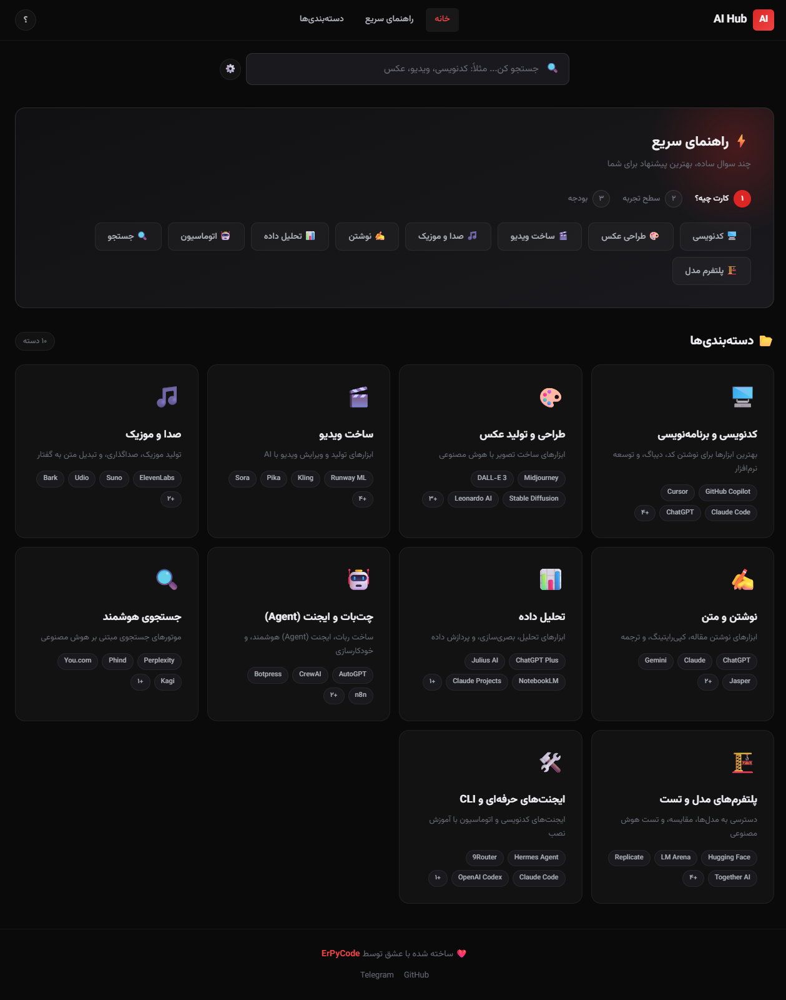

# 🤖 AI Hub

### The Ultimate AI Tools Directory

**A comprehensive, beautiful guide to the best AI tools — organized by category, with smart comparison, favorites, and installation guides.**

---

## 🌟 What is AI Hub?

**AI Hub** is a modern, single-file web application that helps you discover and compare the best AI tools available today. Whether you're a developer, designer, content creator, or just curious about AI — AI Hub has something for you.

> *"If you don't know which AI tool to use for your work, you'll find the answer here."*

### ✨ Key Highlights

- 🎯 **10 Categories** with **65+ AI tools**
- ⚖️ **Smart Comparison** — compare any two tools side-by-side
- 📚 **Installation Guides** — step-by-step setup for professional agents
- ⭐ **Favorites** — save your favorite tools (localStorage)
- 🔍 **Advanced Filter** — filter by category, price, and skill level
- ⌨️ **Keyboard Shortcuts** — power user navigation
- 📱 **PWA Ready** — installable as a mobile app
- 🌙 **Dark Theme** — easy on the eyes
- 🔢 **Persian Numbers** — fully localized for Farsi speakers

---

## 📂 Categories

| Category | Tools | Description |
|----------|-------|-------------|
| 🖥️ **Coding** | 8 | GitHub Copilot, Cursor, Claude Code, ChatGPT, and more |
| 🎨 **Image Generation** | 7 | Midjourney, DALL-E 3, Stable Diffusion, Flux |
| 🎬 **Video Creation** | 8 | Runway ML, Sora, Kling, Higgsfield, and more |
| 🎵 **Audio & Music** | 6 | ElevenLabs, Suno, Udio, and more |
| ✍️ **Writing** | 6 | ChatGPT, Claude, Gemini, Grammarly |
| 📊 **Data Analysis** | 5 | Julius AI, NotebookLM, Claude Projects |
| 🤖 **Agents & Automation** | 6 | AutoGPT, CrewAI, n8n, Make |
| 🔍 **Smart Search** | 5 | Perplexity, Phind, Kagi |
| 🏗️ **Model Platforms** | 8 | Hugging Face, LM Arena, Ollama, Groq |
| 🛠️ **Pro Agents & CLI** | 5 | Hermes Agent, 9Router, Claude Code, Codex, Aider |

---

## ⚡ Features

### 🔍 Smart Search
Type any tool name or category — results appear instantly.

### ⚡ Quick Guide Wizard
Answer 3 simple questions and get personalized AI tool recommendations:
1. What's your task?
2. What's your experience level?
3. What's your budget?

### ⚖️ Tool Comparison
Click the ⚖️ button on any tool card to add it to comparison. When you have 2 tools selected:
- See **overall scores** (out of 100)
- Compare **5 criteria**: Ease of Use, Quality, Features, Value, Speed
- View **feature lists** side by side
- See the **winner** highlighted

### ⭐ Favorites
Click the ⭐ button to save tools to your favorites. Stored in localStorage — works even after closing the browser or installing as PWA.

### 📚 Installation Guides
Professional AI agents (Hermes, 9Router, Claude Code, Codex, Aider) include step-by-step installation guides with copy-to-clipboard commands.

### ⌨️ Keyboard Shortcuts
| Key | Action |
|-----|--------|
| `/` | Focus search |
| `Esc` | Close modals |
| `H` | Scroll to top |
| `C` | Go to categories |
| `?` | Open help |
| `R` | Open random tool |

### 📤 Share
Share tool comparisons via Web Share API (mobile) or clipboard (desktop).

---

## 🛠️ Tech Stack

- **HTML5** — Semantic markup
- **CSS3** — Custom properties, Grid, Flexbox, Animations
- **JavaScript (ES6+)** — Vanilla JS, no frameworks
- **localStorage** — Client-side data persistence
- **PWA** — Service Worker ready

---

## 📄 License

This project is licensed under the MIT License — see the [LICENSE](LICENSE) file for details.

---

## 👨‍💻 Author

**ErPyCode** — [GitHub](https://github.com/erpycode) • [Telegram](https://t.me/erpycodes)

---

**Made with ❤️ by [ErPyCode](https://github.com/erpycode)**

[⬆️ Back to Top](#-ai-hub)

